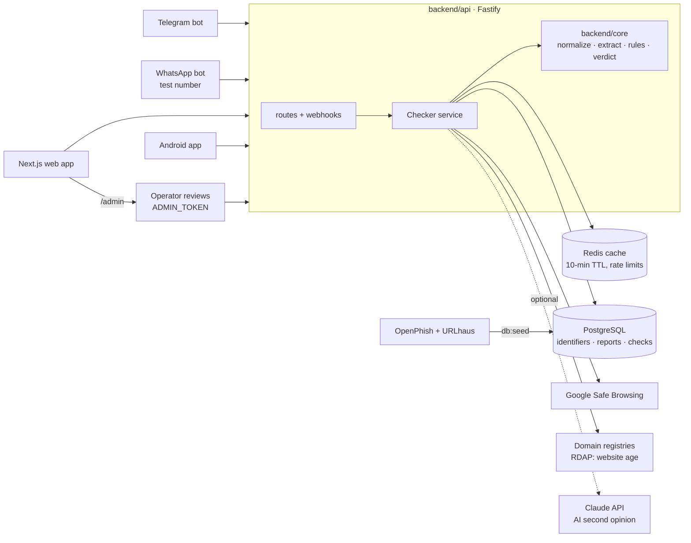

# Sachet

**Stop the scam before the payment.** A real-time scam check for phone numbers, UPI IDs, links
and messages, in Hindi and English. "Sachet" means alert in Hindi.

V1 (26 Oct – 9 Nov 2026) answers one question: _"Is this a scam?"_ When Sachet doesn't know
something, it never says "safe"; it says "No reports yet" and lists the warning signs it found.

## Architecture



- All three channels call the same `Checker`, so they always give the same answer.
- All scam logic lives in `backend/core` as pure functions (no network, no database), which
  makes it easy to test and lets the V2 ML model plug in later.
- Every outside service is optional locally: without `DATABASE_URL` the API uses an in-memory
  store, without `REDIS_URL` an in-memory cache, without bot tokens no bots, without
  `ADMIN_TOKEN` no operator routes, and the AI check stays off unless `AI_CHECK=on`.

```
backend/
  api/
    src/routes/     v1.ts (public API), admin.ts (operator reviews)
    src/services/   checker (one verdict for every channel), appeals,
                    safe-browsing, domain-age (RDAP), ai-check (Claude)
    src/bots/       Telegram + WhatsApp adapters, shared conversation, follow-up job
    scripts/        Telegram webhook setup, eval-ai (rules vs rules + AI)
  core/       normalizers, extractor, 10 scam rules, verdict, card text, redaction
  db/         SQL migrations, Postgres + in-memory stores, phishing-feed import
frontend/
  web/        Next.js website + installable PWA: check, report, appeal, privacy, about, admin
  android/    native Android app (Kotlin, Jetpack Compose), reads screenshots on the phone
data/
  test-messages/  labelled scam and normal messages
```

## Setup

Needs Node.js 20.12+ and pnpm 9.

```bash
pnpm install
cp .env.example .env   # fill in what you have; everything is optional locally
pnpm dev:api           # API on http://localhost:3000
pnpm dev:web           # web app on http://localhost:3001
```

Checks (the same ones CI runs):

```bash
pnpm lint && pnpm format:check && pnpm typecheck && pnpm test
pnpm eval              # rules hit rate / false-alarm rate on data/test-messages
```

### Database (Supabase)

1. Create a Supabase project in the Mumbai region.
2. Copy the **Session pooler** connection string into `DATABASE_URL` in `.env`.
3. `pnpm db:migrate` creates the 5 tables (the API also migrates on start).
4. `pnpm db:seed` imports phishing domains from OpenPhish and URLhaus.

Row Level Security is switched on for every table, so Supabase's public REST API can't read
them; only the API (connecting as the database owner) can.

### Telegram bot

1. Get a token from @BotFather and put it in `TELEGRAM_BOT_TOKEN`.
2. Locally, leave `TELEGRAM_WEBHOOK_SECRET` empty: `pnpm dev:api` runs the bot in polling mode,
   so it works on your phone without a public URL.
3. In production, set `TELEGRAM_WEBHOOK_SECRET` to a random string and register the webhook:
   `https://api.telegram.org/bot<TOKEN>/setWebhook?url=<API_URL>/webhooks/telegram&secret_token=<SECRET>`

Commands: `/start`, `/lang`, `/report [text]`, `/delete`. Any other text is checked. A forwarded
SMS loses its sender, so people can add it on the first line: `From: VM-HDFCBK-S`.

### WhatsApp bot (Meta test number, for demos)

V1 runs WhatsApp on Meta's free test number: it works for up to 5 phone numbers you add as
test recipients, which is enough for demos. A public WhatsApp number needs Meta business
verification (V2).

The bot switches on when all four `WHATSAPP_*` variables are set. Meta must reach the API over
HTTPS, so it only receives real messages once the API is deployed (see `docs/DEPLOY.md`).
Every POST is checked against the `X-Hub-Signature-256` HMAC; retried deliveries are handled
once.

### Installable web app (PWA) and Android Share menu

The web app can be installed from the browser ("Add to home screen" button on Android, "Add to Home
Screen" on iPhone). Once installed on Android, Sachet appears in the **Share** menu: long-press a
message in WhatsApp or SMS → Share → Sachet, and `/share` checks it straight away.

- `app/manifest.ts`: name, icons and the `share_target` (GET `/share?title=&text=&url=`).
- `app/pwa-icons/[size]`: app icons drawn from code at build time.
- `public/sw.js`: only shows an offline page with the 1930 helpline. It never caches answers,
  because a stale "No reports yet" could be dangerous.
- Browsers allow install and Share only on **HTTPS** (or localhost on the same device), so test
  it on a phone after deploying to Vercel. iPhone supports install but not the Share target.

### Owner reviews (appeals)

If an honest number, UPI ID or website gets reported, its owner can ask for a review: the
result card links to `/appeal` (the value travels in the `#fragment`, never the query string).
While a review is open, checks say so but keep their band. An operator decides on `/admin`:

1. Set `ADMIN_TOKEN` (`openssl rand -hex 32`) on the API. Without it the operator routes don't exist.
2. Open `<web>/admin`, paste the token (kept only in that tab's memory), load the open appeals.
3. **Uphold** sets every earlier report aside (newer reports still count; a blocklist entry drops
   to "unknown"); **Reject** keeps them. Either way the owner's contact is deleted.

### Website age (RDAP)

For every link, the API asks the domain's registry when it was registered (RDAP, the public
successor to WHOIS; servers from IANA's list, no key). A website registered in the last 30 days
is a warning sign on its own (medium risk): phishing sites are usually days old. Answers are
cached for 7 days; a slow registry is skipped after 1 second. Turn it off with
`DOMAIN_AGE_LOOKUP=off`.

### AI second opinion (optional)

With `AI_CHECK=on` and an `ANTHROPIC_API_KEY`, messages the rules don't already mark high risk
also go to Claude (`AI_CHECK_MODEL`, default `claude-opus-5-5`) for a second opinion:

- Only **redacted** text is sent, and the answer is fixed to yes/no, one of the 10 scam types and
  a confidence. It can raise a verdict to **medium**, never to high and never lower.
- A check waits at most `AI_CHECK_WAIT_MS` (3 s). Answers are cached for 7 days by message, and a
  late answer still fills the cache, so the next person who checks a viral scam gets it at once.
- It costs money per new message. Measure it first: `pnpm eval:ai --yes` prints hit and
  false-alarm rates for rules only, AI only, and rules + AI on the test set. Switch it on only
  if rules + AI catch more without more false alarms.

### Android app

Native Kotlin app in `frontend/android`: check, report, Share menu, screenshots, privacy,
English/Hindi. A screenshot (shared to Sachet, or picked with "📷 Check a screenshot") is read
on the phone with ML Kit (Hindi and English) and only its text is checked; the picture is never
uploaded.
See [frontend/android/README.md](frontend/android/README.md) to build and run it.

## API

| Endpoint                                    | Input                                                                | Returns                                                         |
| ------------------------------------------- | -------------------------------------------------------------------- | --------------------------------------------------------------- |
| `GET /v1/check?type=phone\|upi\|url&value=` | one identifier                                                       | band, label, reasons, advice (en + hi), reportCount, checkId    |
| `POST /v1/check/message`                    | `{ text, sender? }`                                                  | the same, plus extracted identifiers, amounts, signals, sender  |
| `POST /v1/reports`                          | `{ identifiers?, text?, scamType?, amountInr? }` + `Idempotency-Key` | `202 { reportId, duplicate }`                                   |
| `POST /v1/checks/:id/paid`                  | `{ paid: "yes" \| "no" }`                                            | `204` (counts money protected; only the checker can answer)     |
| `POST /v1/appeals`                          | `{ type, value, reason, contact? }`                                  | `202 { appealId }`, `404` nothing to review, `409` already open |
| `GET /v1/admin/appeals?status=open`         | `Authorization: Bearer <ADMIN_TOKEN>`                                | appeals with the newest reports about each identifier           |
| `POST /v1/admin/appeals/:id`                | `{ decision: "upheld" \| "rejected", note? }` + the same header      | `{ status, identifier }`                                        |
| `GET /v1/stats`                             | –                                                                    | checks, reports, moneyProtectedInr (counted once a minute)      |
| `DELETE /v1/me`                             | `X-Client-Id` header                                                 | deleted counts                                                  |
| `GET /health`                               | –                                                                    | database and cache status                                       |

Headers: `X-Client-Id` (the browser's or app's random ID) and `X-Sachet-Client: android` from the
app, which only labels its checks and reports as the `android` channel.

Limits: 60 checks a minute per network, 20 reports an hour per person and 30 per network,
5 appeals a day per network, 10 wrong admin tokens an hour per network.
On the web, reports about one identifier count once per network, so one person can't fake
"3 different people".

## Verdict rules (V1 baseline)

- **High risk:** on a phishing list or flagged by Safe Browsing, reported by 3+ different
  people, or a strong scam-pattern match together with a danger sign (payment demand, OTP/PIN
  request, .apk, look-alike domain, IP link).
- **Medium risk:** 1–2 reports, a scam-type match, 2+ warning signs, a website registered in the
  last 30 days, or (when switched on) the AI check reading it as a likely scam.
- **No reports yet:** nothing found. Shows any warning signs, never the word "safe".
- An open owner review, or reports set aside after one, is shown as a reason. Neither ever lowers
  the band by itself.

### SMS sender

When the user gives the sender, Sachet labels it from TRAI's sender format (`VM-HDFCBK-S`):
promotional (-P), service (-S), transactional (-T), government (-G), a registered business, an
ordinary mobile number, or a foreign number. The label is information only and never lowers
the risk. Two warning signs come from it: a "bank / government" message sent from an ordinary
number, and any foreign number.

Whenever a phone number or UPI ID is involved, the advice also points to cybercrime.gov.in →
"Report & Check Suspect", the police complaint search (it has no API, so we link to it).

### Test set results

Run `pnpm eval`. Current numbers on `data/test-messages/messages.json`:

| Set                         | Messages | Hit rate | False-alarm rate |
| --------------------------- | -------- | -------- | ---------------- |
| Synthetic starter set       | 50 + 20  | 100%     | 0%               |
| Real messages (to be added) | –        | –        | –                |

The starter set was written alongside the rules, so its numbers are optimistic. The real V1
baseline comes from the 50+ real scam messages collected from family groups and SMS.

## Privacy and security

Reporter IDs are stored only as salted HMAC hashes. Message text is redacted (names, OTPs,
emails, Aadhaar, PAN, card and account numbers) before saving. Users can delete their data
with `/delete` in the bots or the button on the web privacy page.

[docs/SECURITY.md](docs/SECURITY.md) has the trust boundaries, each threat and what stops it,
the known gaps, and the launch checklist.

## Status

| Day | Build                                          | Status                        |
| --- | ---------------------------------------------- | ----------------------------- |
| 1   | Monorepo, TypeScript, ESLint, Vitest, CI       | Done                          |
| 2   | Normalizers: phone, UPI ID, URL                | Done                          |
| 3   | Migrations, seed script                        | Code done, needs Supabase     |
| 4–5 | Check + report API, cache, idempotency, limits | Code done, needs Upstash      |
| 6–7 | Extractor, rules for 10 scam types             | Done, needs real messages     |
| 8   | Safe Browsing + phishing feeds                 | Code done, needs API key      |
| 9   | Telegram bot                                   | Code done, needs token        |
| 10  | WhatsApp webhook (test number)                 | Keys valid, needs deploy      |
| 11  | Language choice, report flow, follow-up        | Done                          |
| 12  | Web app: check, result card, report form, PWA  | Done, PWA needs HTTPS test    |
| 13  | Hindi text, privacy notice, about page         | Done, Hindi needs review      |
| 14  | Deploy (Docker, Railway/Render, Vercel)        | Image built and checked in CI |
| 15  | Demo day: 20 testers                           | Not started                   |
| +   | Bot `/privacy` notice                          | Done                          |
| +   | Owner appeals + operator review page           | Done, needs `ADMIN_TOKEN`     |
| +   | New-website warning (RDAP)                     | Done                          |
| +   | AI second opinion (Claude)                     | Done, off until measured      |
| +   | Android: check screenshots on the phone (OCR)  | Done, needs a real-phone test |

## V2 list

Scope for V1 is frozen; new ideas go here.

| Idea                                                   | Why                                                                 |
| ------------------------------------------------------ | ------------------------------------------------------------------- |
| WhatsApp bot on a verified business number             | Code is ready; needs Meta business verification.                    |
| Own Hinglish ML classifier (MuRIL / IndicBERT)         | Once there are thousands of labelled reports; must beat rules + AI. |
| Per-person operator accounts                           | `/admin` has one shared token, so decisions aren't attributed.      |
| Screenshot check on the website                        | Android reads screenshots; the web would need OCR in the browser.   |
| Queue + workers, fraud graph, link sandbox, SEBI check | From the original V2 plan.                                          |
| Native Android app (SMS + call screening) — V3         | Needs months and Play Store SMS/call permission approval.           |
